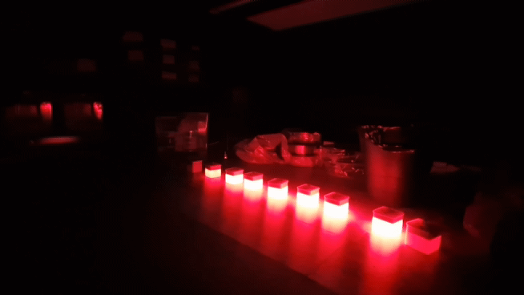
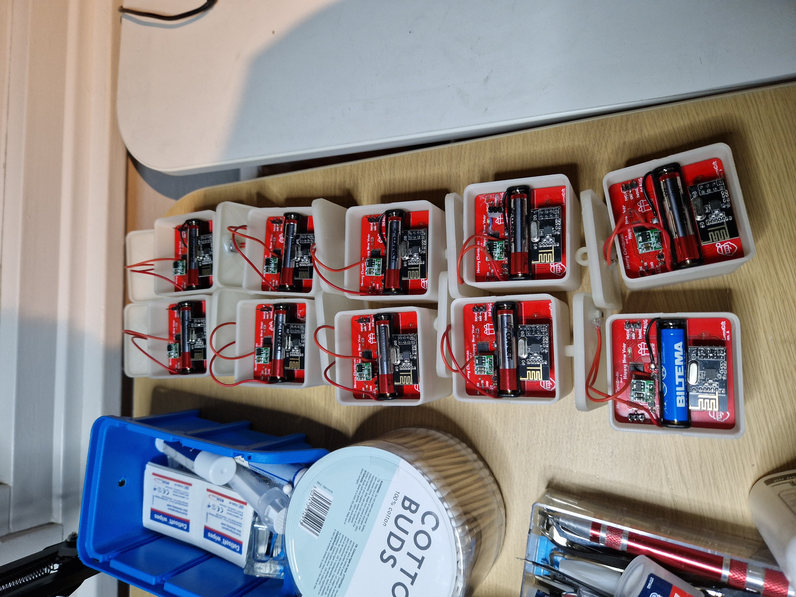
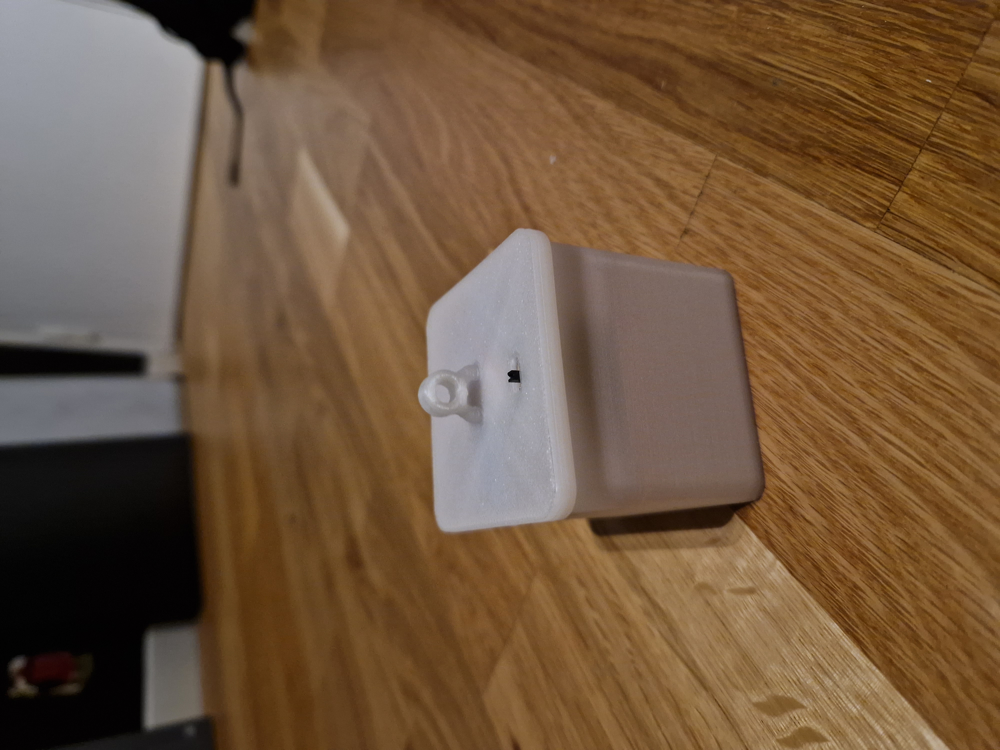
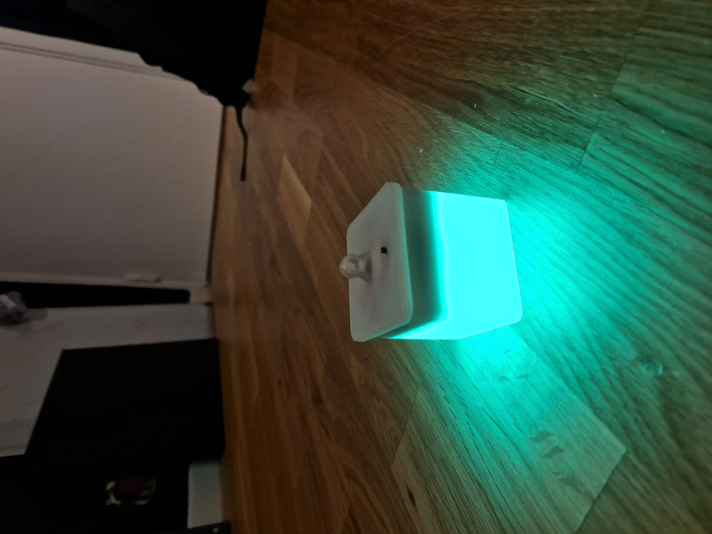
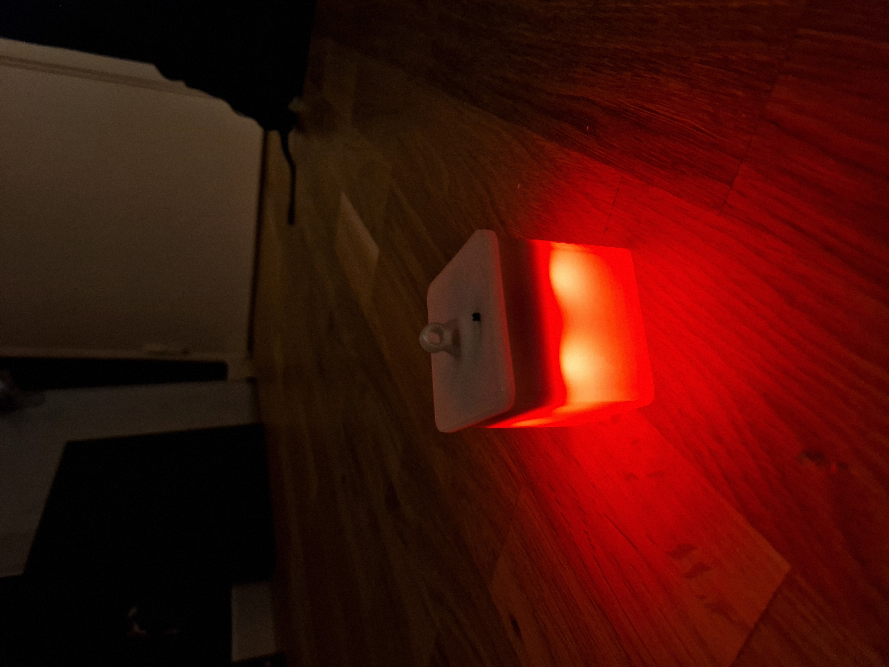
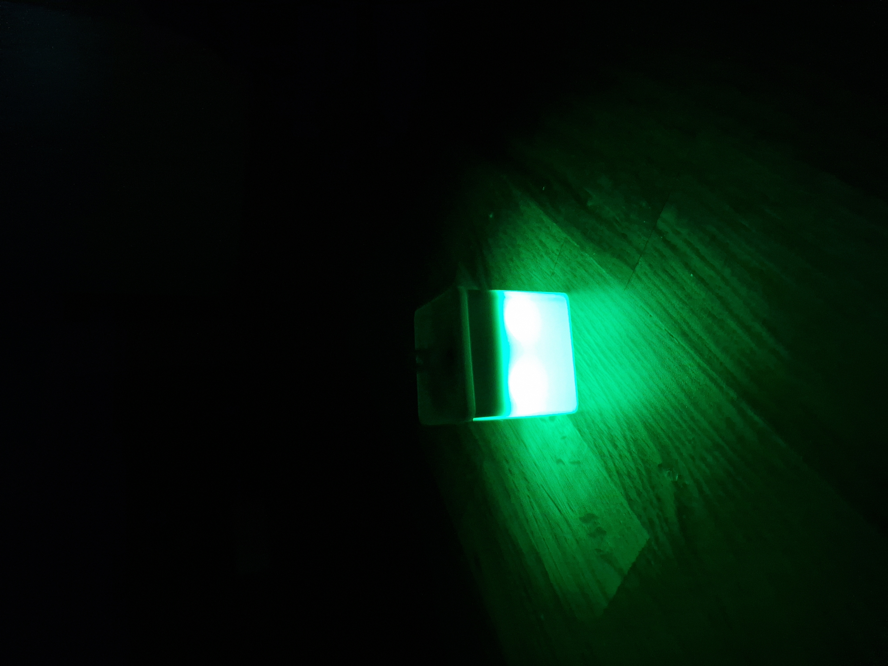

# Lumigift

Glowing Christmas presents that dance to music. Each Lumigift is a small 3D-printed
box with four RGB LEDs, a radio and an AAA battery. A computer runs the show over
2.4 GHz radio: live telemetry from every box, firmware updates for all of them at
once in seconds, and light shows synced to the beat of a song.



## What's in here

| Path | What |
|---|---|
| `kicad/lumigift-rev-a/` | Gift PCB: STM32C011F6, 4× WS2812B, nRF24L01+ socket, AAA boost |
| `firmware/lumigift/` | Gift firmware in Rust: a 10 KiB write-protected radio bootloader + the app |
| `firmware/nrf24-usb-bridge/` | USB ⇄ nRF24 bridge dongle (STM32F103C8 + nRF24L01+PA/LNA), generic and reusable |
| `crates/` | Shared `no_std` crates: radio driver, bridge protocol, gift protocol, LED effects |
| `host/lumigift-core` | Radio link manager: polling, telemetry, discovery, OTA, simulator |
| `host/lumigift-audio` | Audio decoding, playback clock, beat/section/drop analysis, shows |
| `host/lumigift-stage` | Real-time 3D stage renderer (wgpu) |
| `host/lumigift-studio` | The desktop app |
| `host/lumigift-cli` | Command-line tool |
| `docs/` | [Architecture](docs/ARCHITECTURE.md) and [UI design](docs/UI_DESIGN.md) |

Everything is Rust. The radio driver and protocols are written from scratch, and the
LED effects are one crate that runs both on the gifts and in the 3D preview, so the
preview shows exactly what the hardware will do.

## Quick start (no hardware needed)

```sh
cargo run --release -p lumigift-studio -- --sim 10   # the app, with 10 simulated gifts
cargo run --release -p lumigift-cli -- --sim 10 scan # or the CLI
cargo run --release -p lumigift-stage --example demo # just the 3D stage
```

## With hardware

1. **Bridge dongle:** wire the nRF24 module to the F103 board, switch the board's
   USB-C data lines from the CH340 to PA11/PA12, add a 1.5 kΩ pull-up from PA12 to
   3V3 (the board has none: the CH340 had it built in), and flash it once with an
   ST-Link (`firmware/nrf24-usb-bridge/flash-swd.sh`). After that it updates over
   USB: `lumigift bridge-update <elf>`. See
   [`firmware/nrf24-usb-bridge/README.md`](firmware/nrf24-usb-bridge/README.md), which
   also has the udev rule.
2. **Gifts (once per board, over SWD):** `cd firmware/lumigift && cargo xtask flash`
   writes the bootloader and the app. See [`firmware/lumigift/README.md`](firmware/lumigift/README.md).
3. **From then on, update every gift over the air:**
   ```sh
   cd firmware/lumigift && cargo xtask image                # → target/lumigift-app.img
   cargo run --release -p lumigift-cli -- ota firmware/lumigift/target/lumigift-app.img
   ```
   or drop the image into the Firmware page of the Studio.

## How it works

* **Radio link:** the bridge broadcasts a show frame 100 times a second, carrying a
  timestamp that keeps every gift's clock locked to the bridge. Between frames it
  polls each gift, and the gift answers inside the hardware ack with uptime,
  battery, link quality, reset reason and firmware version.
* **Firmware update:** a reboot command drops the gifts into their bootloader. The
  image goes out as broadcast chunks to all of them at once, each gift reports
  what it missed, those chunks are resent, and each image is CRC-checked before it
  boots. A power cut mid-update just leaves the gift waiting in its bootloader.
* **Music:** a song is analysed up front (tempo, beats, bars, sections, drops). A
  show is a timeline of effect and palette cues, generated automatically and
  editable in the Studio. During playback the host sends compact music frames
  (band energies, beat phase and flags) a little ahead of the audio, so the gifts
  light up exactly in time with what you hear.

Details are in [docs/ARCHITECTURE.md](docs/ARCHITECTURE.md).

## Design

The PCB fits snugly in the 3D-printed box, and the lid snaps on tight enough to stay on.






